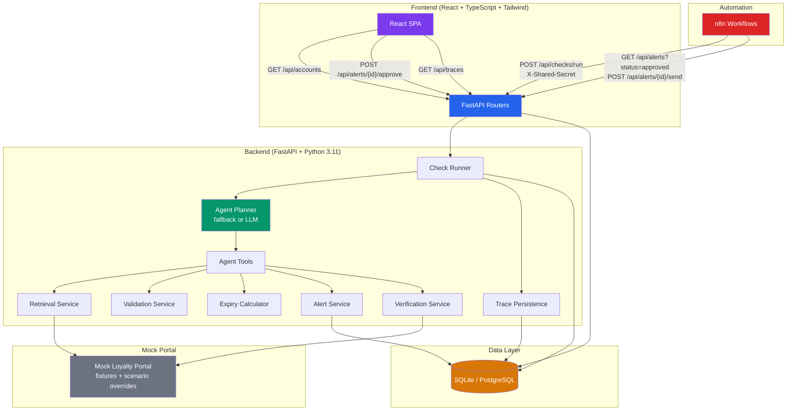

# LoyaltyGuard AI

> **Agentic loyalty-points & gift-card expiry tracker with human-in-the-loop approval**

An AI-powered agent autonomously monitors loyalty program balances, detects expiring rewards within a 7-day window, creates alert proposals for human review, and sends notifications only after explicit approval. Built with FastAPI, React, and a deterministic fallback planner (with optional LLM upgrade).

---

## 🌐 Live URL

```
https://loyaltyguard-ai.onrender.com
```

| Page | URL |
|------|-----|
| React UI | `/` |
| Swagger API Docs | `/docs` |
| Health Check | `/health` |

---

## 🏗️ Architecture



### Data flow

1. **Schedule** — n8n fires daily at 06:00 → `POST /api/checks/run` with shared secret
2. **Retrieve** — Agent fetches balance + batches from the mock portal
3. **Validate** — Pydantic schema validation, unit consistency, negative amount rejection
4. **Compute** — Identify batches expiring within 7 days (inclusive, Asia/Kolkata timezone)
5. **Propose** — Create deduplicated `pending` alert proposals (DB UNIQUE constraint)
6. **Verify** — Post-run re-read compares stored vs observed portal state
7. **Approve** — Human reviews proposals in the React UI → approves or rejects
8. **Send** — n8n polls approved proposals → idempotent simulated send

---

## 🖥️ Local Setup (Windows PowerShell)

### Prerequisites

- Python 3.11+ ([python.org](https://python.org))
- Node.js 18+ ([nodejs.org](https://nodejs.org))
- Git

### 1. Clone the repo

```powershell
git clone https://github.com/pawaralok8888-oss/loyaltyguard-ai.git
cd loyaltyguard-ai
```

### 2. Create Python virtual environment

```powershell
py -3.11 -m venv backend\venv
.\backend\venv\Scripts\Activate.ps1
pip install -r backend\requirements.txt
```

> If `Activate.ps1` is blocked, run once:
> ```powershell
> Set-ExecutionPolicy -Scope CurrentUser -ExecutionPolicy RemoteSigned
> ```

### 3. Create local `.env` file

```powershell
Copy-Item .env.example .env
```

Edit `.env` and set `MOCK_ADMIN_ENABLED=true` for local development.

### 4. Start the backend (Terminal 1)

```powershell
cd "path\to\loyaltyguard-ai"
.\backend\venv\Scripts\python.exe -m uvicorn backend.app.main:app --reload --host 127.0.0.1 --port 8000
```

### 5. Install frontend dependencies and start dev server (Terminal 2)

```powershell
cd "path\to\loyaltyguard-ai\frontend"
npm install
npm run dev
```

### 6. Open in browser

- **React UI**: http://localhost:5173
- **API Docs**: http://localhost:8000/docs
- **Health**: http://localhost:8000/health

---

## 🧪 Run Tests

```powershell
cd "path\to\loyaltyguard-ai"
.\backend\venv\Scripts\python.exe -m pytest backend\tests\ -v
```

All 32 tests should pass:

| Test File | Tests | What it covers |
|-----------|-------|----------------|
| `test_official_tc1_tc4.py` | 5 | TC1–TC4 official scenarios + dedupe restart |
| `test_extra.py` | 7 | Boundary, malformed, mixed units, verification, send rules |
| `test_agent_planner_phase3.py` | 9 | Agent planner, tools, LLM fallback, traces |
| `test_api_endpoints.py` | 3 | API check/run, bulk secret, expiries |
| `test_phase5_deployment.py` | 8 | Mock admin gating, secret enforcement, seed, config |

---

## ⚙️ Environment Variables

| Variable | Required | Description |
|----------|----------|-------------|
| `DATABASE_URL` | Yes | SQLite or PostgreSQL connection string |
| `N8N_SHARED_SECRET` | Yes | Shared secret for `/api/checks/run` and mock admin |
| `PORTAL_BASE_URL` | Yes | Base URL of the deployed app (for self-referential portal calls) |
| `ENVIRONMENT` | No | `development` or `production` (default: `development`) |
| `HOST` | No | Bind host (default: `127.0.0.1`) |
| `PORT` | No | Bind port (default: `8000`) |
| `MOCK_ADMIN_ENABLED` | No | `true` to enable `/mock/admin/*` endpoints (default: `false`) |
| `LLM_PROVIDER` | No | `fallback` (default), `openai`, `anthropic`, or `gemini` |
| `LLM_API_KEY` | No | API key for the selected LLM provider |
| `FROZEN_DATETIME` | No | ISO datetime string to freeze the clock (testing only) |

> ⚠️ **No real values are stored in the repository.** See `.env.example` for the template.

---

## 🔒 Synthetic Data Only

This project uses **100% synthetic data**:

- All loyalty accounts, users, and balances are fictional demo data
- The mock portal returns hardcoded fixture responses — no real commercial portals are accessed
- No real credentials, OTPs, CAPTCHAs, or personal information are used anywhere
- No scraping of real loyalty program websites occurs
- Email/phone notifications are simulated in-app (not actually sent)

---

## 📁 Project Structure

```
loyaltyguard-ai/
├── backend/
│   ├── app/
│   │   ├── agent/          # Planner, tools, trace persistence
│   │   ├── mock_portal/    # Synthetic loyalty portal with scenario overrides
│   │   ├── routers/        # FastAPI endpoint definitions
│   │   ├── services/       # Core business logic
│   │   ├── clock.py        # Injectable clock (UTC internal, IST display)
│   │   ├── config.py       # Pydantic settings from .env
│   │   ├── db.py           # SQLAlchemy engine and session
│   │   ├── main.py         # FastAPI app with lifespan startup
│   │   ├── models.py       # SQLAlchemy ORM models
│   │   └── schemas.py      # Pydantic request/response schemas
│   ├── scripts/            # Seed script, trace exporter
│   ├── tests/              # 32 pytest tests across 5 files
│   └── requirements.txt
├── frontend/
│   ├── src/
│   │   ├── components/     # 5 React view components
│   │   ├── api/            # API client with relative /api base
│   │   └── types/          # TypeScript interfaces
│   └── vite.config.ts      # Dev proxy to port 8000
├── evidence/               # Pytest output, TC traces, evidence README
├── n8n/                    # n8n workflow JSONs + README
├── docs/                   # Demo script, screenshot checklist
├── render.yaml             # Render deployment config
├── railway.toml            # Railway deployment config
├── smoke_test.py           # Zero-dependency deployment smoke test
├── DEPLOYMENT.md           # Full deployment guide
└── .env.example            # All env vars documented (no values)
```

---

## ⚠️ Limitations

1. **Mock portal only** — The system reads from a built-in synthetic portal; no real loyalty program APIs are integrated
2. **Simulated notifications** — Notifications are recorded in-app; no actual email, SMS, or push delivery
3. **SQLite in production** — Free-tier Render uses SQLite with a persistent disk; data may be lost on redeploy without a managed PostgreSQL addon
4. **Single-user demo** — No authentication or multi-user support; the demo seeds one synthetic user
5. **Deterministic planner default** — The fallback planner follows a fixed decision tree; LLM planning requires an API key
6. **Free-tier cold starts** — Render free tier spins down after 15 minutes of inactivity (~30s wake time)
7. **No real-time updates** — The React UI polls on page load; there is no WebSocket or SSE push

---

## 🔮 Future Scope

1. **Real loyalty API integrations** — Plug in real provider APIs (Air India, HDFC SmartBuy, Amazon Pay) behind proper OAuth flows
2. **Real notification channels** — SendGrid email, Twilio SMS, Slack webhook, or Firebase push
3. **Multi-user authentication** — OAuth 2.0 or magic-link login with per-user account isolation
4. **PostgreSQL migration** — Alembic migrations for schema versioning on managed Postgres
5. **LLM-powered planning** — Upgrade the agent to use GPT-4/Claude/Gemini for dynamic decision-making
6. **WebSocket real-time dashboard** — Push live check progress and alert status updates
7. **Mobile app** — React Native companion app for on-the-go approval and notifications
8. **Multi-currency support** — Handle reward programs with different currencies and conversion rates
9. **Audit trail** — Immutable log of all agent decisions and human approvals for compliance

---

## 📄 License

This project is a portfolio submission. All data is synthetic. No real commercial loyalty program data is accessed or stored.
